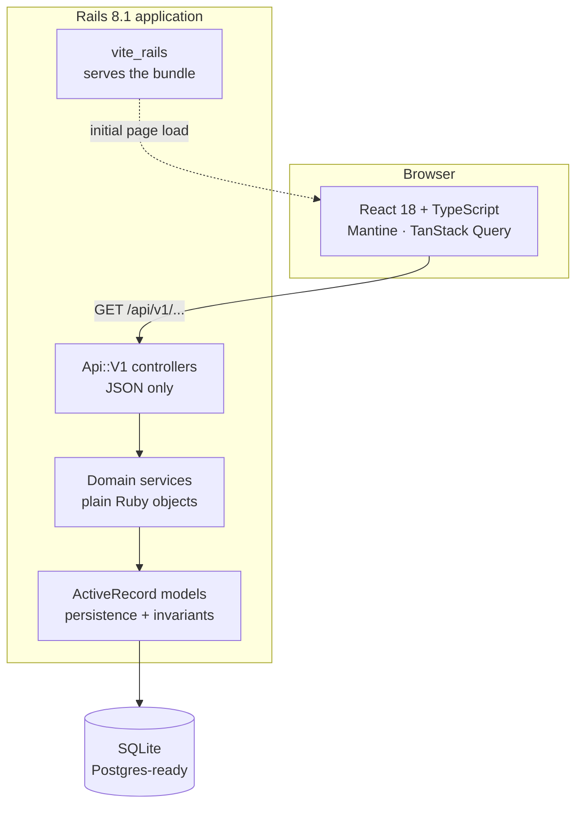
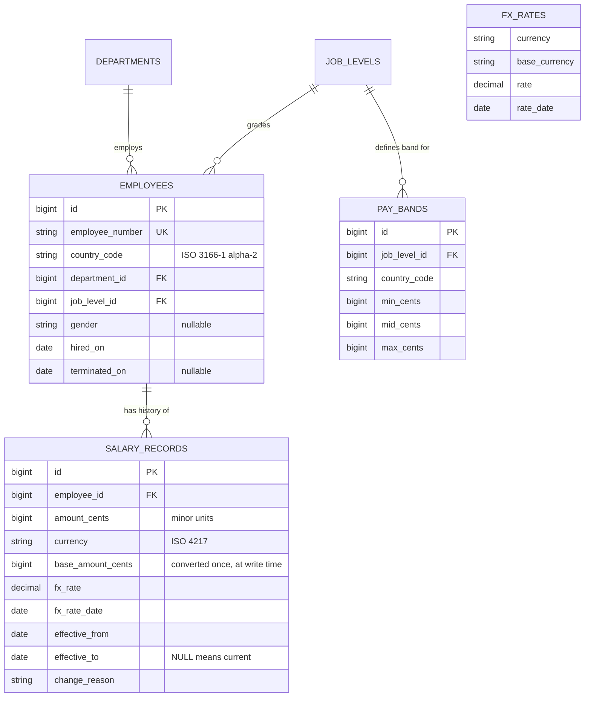
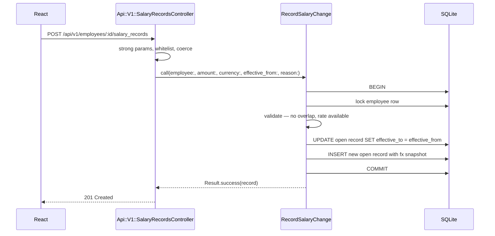

# Architecture

One Rails 8.1 application serving a React SPA, backed by SQLite. Decisions behind this shape are
recorded in [docs/adr](adr/README.md).

## System shape



The important line is `api --> services`. Controllers parse parameters, call one service, and
render. They hold no business logic. Services are plain Ruby objects with no Rails dependency
beyond the models they touch, which is what makes them fast and pleasant to test.

## Data model



### The invariant that matters

```sql
CREATE UNIQUE INDEX idx_salary_records_current
  ON salary_records (employee_id) WHERE effective_to IS NULL;
```

An employee has at most one open salary record, enforced by the database rather than by convention.
A concurrent double-submit raises a constraint violation instead of creating two live salaries.
The same index makes "current pay for everyone" a single cheap scan.

## Request flow — recording a pay change



Close-then-insert runs in one transaction. If the insert violates the partial unique index, the
close is rolled back with it, so the employee is never left with no current salary.

## Layout

```
app/
  controllers/api/v1/    JSON controllers, thin
  models/                persistence and invariants
  services/              domain logic, plain Ruby
    salaries/            RecordSalaryChange, SalaryHistory
    insights/            PayrollTotals, Distribution, Outliers, PayEquity
  values/                Money and other value objects
  javascript/            React app
db/
  seeds/                 deterministic 10,000-employee generator
spec/                    RSpec — unit heavy, request specs at the edges
docs/                    requirements, ADRs, engineering notes
```
